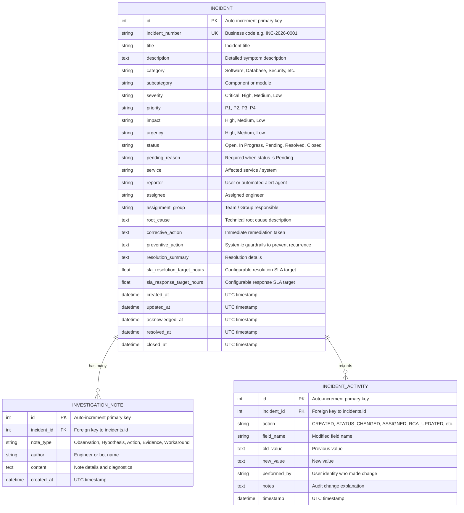
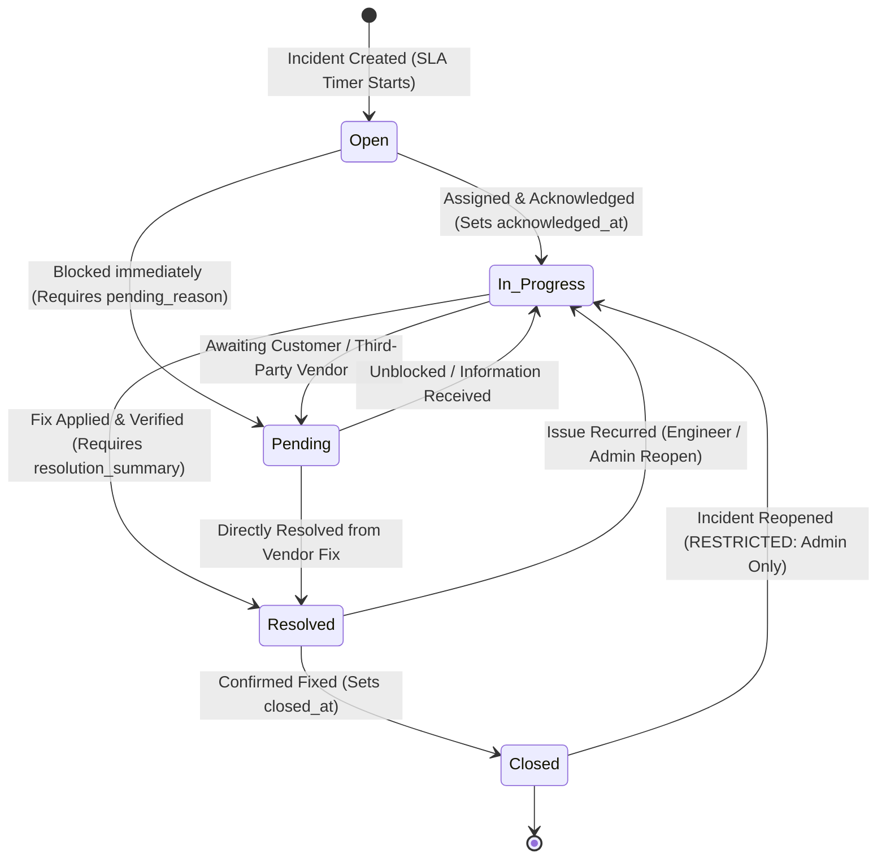

# IT Incident Management and Root Cause Analysis (RCA) Platform

[](https://www.python.org/downloads/)
[](https://fastapi.tiangolo.com/)
[](https://www.sqlalchemy.org/)
[](https://docs.pydantic.dev/)
[](https://streamlit.io/)
[](https://pytest.org/)

An enterprise-grade, locally runnable IT Incident Management and Root Cause Analysis (RCA) Platform built by senior backend and IT operations engineers. This platform implements rigorous ITIL incident lifecycle tracking, dynamic Service-Level Agreement (SLA) calculations, structured RCA workflows (5-Whys, corrective and preventive actions), immutable activity audit trails, operational metrics (MTTR, MTTA, SLA compliance), sensitive data masking, Role-Based Access Control (RBAC), and an interactive Streamlit operations dashboard.

---

## Table of Contents
1. [Problem Statement](#1-problem-statement)
2. [Existing Approaches & Architectural Evaluation](#2-existing-approaches--architectural-evaluation)
3. [Proposed Solution & System Architecture](#3-proposed-solution--system-architecture)
4. [Database Schema & Data Model](#4-database-schema--data-model)
5. [ITIL Lifecycle & SLA Engine](#5-itil-lifecycle--sla-engine)
6. [Root Cause Analysis (RCA) Workflow](#6-root-cause-analysis-rca-workflow)
7. [Security, Authentication & Role-Based Access Control (RBAC)](#7-security-authentication--role-based-access-control-rbac)
8. [Sensitive Data Logging Protection](#8-sensitive-data-logging-protection)
9. [ITSM Dataset Integration](#9-itsm-dataset-integration)
10. [Streamlit Operations Dashboard](#10-streamlit-operations-dashboard)
11. [REST API Documentation & Endpoint Reference](#11-rest-api-documentation--endpoint-reference)
12. [Realistic API Request & Response Examples](#12-realistic-api-request--response-examples)
13. [Local Installation & Setup Guide](#13-local-installation--setup-guide)
14. [Testing Suite & Quality Assurance](#14-testing-suite--quality-assurance)
15. [Limitations & Security Notices](#15-limitations--security-notices)
16. [Future Enhancements Roadmap](#16-future-enhancements-roadmap)

---

## 1. Problem Statement

Modern enterprise engineering organizations run distributed cloud applications, microservices, databases, and message brokers. When production outages or service degradations occur, support and Site Reliability Engineering (SRE) teams face critical friction points:

- **Fragmented Incident Records**: Incident details are often dispersed across Slack channels, monitoring alerts, ad-hoc tickets, and spreadsheets.
- **Ambiguous Triage & Prioritization**: Lack of standardized severity scoring (P1–P4) causes delays in triage and assigning appropriate engineer response tiers.
- **Unmanaged SLA Drift**: Teams miss SLA targets because deadline tracking is calculated manually or after the incident is already closed.
- **Superficial Post-Mortems**: RCA is frequently treated as an afterthought; teams record quick patches without documenting the verified root cause, 5-Whys analysis, immediate corrective fixes, or long-term preventive guardrails.
- **Unreliable Operational Metrics**: Without automated tracking, metrics like Mean Time to Acknowledge (MTTA), Mean Time to Resolve (MTTR), and SLA compliance rates are skewed or unmeasurable.

---

## 2. Existing Approaches & Architectural Evaluation

| Approach | Strengths | Critical Drawbacks |
| :--- | :--- | :--- |
| **Spreadsheets / Google Sheets** | Zero setup barrier, easily customizable columns | No automated SLA timers, no state machine enforcement, lack of concurrency control, no tamper-proof audit trail. |
| **Email Threads & Chat (Slack/Teams)** | High-speed collaboration during live outages | Fleeting context, zero structured RCA documentation, impossible to query historical MTTR trends or generate SLA compliance statistics. |
| **Enterprise ITSM (ServiceNow, Jira Service Mgmt)** | Comprehensive ecosystem, extensive integration | Heavy operational overhead, steep licensing costs, complex configuration requiring dedicated admin staff. *(Note: This project does not claim integration with ServiceNow unless explicitly configured via authenticated webhook connectors).* |
| **This Platform (FastAPI + SQLite + Streamlit)** | **Locally runnable, zero external cloud dependencies, strict ITIL state machine, automated SLA engine, embedded RCA workflows, and real-time operations dashboard.** | Lightweight local SQLite database suited for dedicated teams and edge deployments; scaling to multi-region multi-tenant clusters requires migrating SQLite to PostgreSQL. |

---

## 3. Proposed Solution & System Architecture

The platform is designed following Clean Architecture and Separation of Concerns:

```mermaid
graph TD
    subgraph Client Layer
        WebUI[Streamlit Operations Dashboard\n:8501]
        Swagger[FastAPI Interactive Docs / Swagger UI\n:8000/docs]
        APIClient[REST API Consumer / Curl / CI-CD]
    end

    subgraph Security & Middleware
        Auth[Auth & RBAC Middleware\nBasic Auth / X-API-Key]
        Masking[Sensitive Data Log Filter\nToken/Password Masking]
        CORS[CORS & Exception Handlers]
    end

    subgraph API Routing Layer
        IncRouter[/api/v1/incidents]
        NotesRouter[/api/v1/incidents/{id}/notes]
        RCARouter[/api/v1/incidents/{id}/rca]
        MetricsRouter[/api/v1/reports/*]
        SeedRouter[/api/v1/seed/*]
    end

    subgraph Service & Business Logic Layer
        IncService[Incident Service\nCRUD, State Machine, SLA Calculation]
        RCAService[RCA Service\nInvestigation Notes & Post-Mortem]
        MetricService[Metrics Service\nMTTR, MTTA, SLA Compliance]
        SLAEngine[SLA Rules Engine\nAge, Deadlines & Breach Detection]
    end

    subgraph Data & Persistence Layer
        DB[(SQLite Engine / WAL Mode\nincidents.db)]
        CSVData[(UCI Incident Event Log\nincident_event_log.csv)]
    end

    WebUI -->|Direct Session / REST| IncService
    Swagger --> Auth
    APIClient --> Auth
    Auth --> CORS --> Masking

    Masking --> IncRouter
    Masking --> NotesRouter
    Masking --> RCARouter
    Masking --> MetricsRouter
    Masking --> SeedRouter

    IncRouter --> IncService
    NotesRouter --> RCAService
    RCARouter --> RCAService
    MetricsRouter --> MetricService
    SeedRouter --> DB

    IncService --> SLAEngine
    MetricService --> SLAEngine
    IncService --> DB
    RCAService --> DB
    MetricService --> DB
    SeedRouter --> CSVData
```

### Directory Structure
```
project_a_incident_rca/
├── app/
│   ├── __init__.py               # Application package definition
│   ├── main.py                   # FastAPI application initialization & middleware
│   ├── config.py                 # Pydantic Settings (.env configuration & SLA rules)
│   ├── database.py               # SQLAlchemy 2.0 engine, SessionLocal, WAL mode
│   ├── security.py               # Basic Auth, API Key authentication & RBAC
│   ├── logging_config.py         # Structured logging with sensitive data masking
│   ├── models/                   # SQLAlchemy ORM database models
│   │   ├── __init__.py
│   │   ├── incident.py           # Incident model
│   │   ├── activity.py           # IncidentActivity audit history model
│   │   └── investigation_note.py # InvestigationNote model
│   ├── schemas/                  # Pydantic schemas (V2 compliant)
│   │   ├── __init__.py
│   │   ├── common.py             # Enums, Pagination & Health schemas
│   │   ├── incident.py           # IncidentCreate, Update, Transition & Response
│   │   ├── note.py               # InvestigationNote schemas
│   │   ├── rca.py                # RCA documentation schemas
│   │   ├── activity.py           # Activity response schema
│   │   └── metrics.py            # Operational metrics & executive reports
│   ├── services/                 # Business logic layer
│   │   ├── __init__.py
│   │   ├── incident_service.py   # State machine, SLA calculations, filters
│   │   ├── rca_service.py        # RCA recording & investigation notes
│   │   └── metrics_service.py    # MTTR, MTTA, SLA adherence & reporting
│   ├── api/                      # REST API routers
│   │   ├── __init__.py
│   │   └── v1/
│   │       ├── __init__.py
│   │       ├── incidents.py      # Incident lifecycle endpoints
│   │       ├── notes.py          # Investigation note endpoints
│   │       ├── rca.py            # RCA and audit endpoints
│   │       ├── metrics.py        # Analytics & summary reports
│   │       └── seed.py           # Demo seeding and CSV ingestion endpoints
│   └── utils/
│       ├── __init__.py
│       ├── sla.py                # SLA target rules & breach evaluator
│       └── timezone.py           # UTC ISO-8601 formatting & age calculator
├── dashboard.py                  # Streamlit visual operations dashboard
├── scripts/
│   ├── __init__.py
│   ├── init_db.py                # Schema initialization utility
│   └── seed_data.py              # Curated scenarios & CSV ETL importer
├── tests/                        # Comprehensive Pytest test suite (21 tests)
│   ├── __init__.py
│   ├── conftest.py               # In-memory SQLite fixtures & authenticated clients
│   ├── test_incidents.py         # CRUD, search, validation, and metadata tests
│   ├── test_status_transitions.py# State machine and RBAC transition tests
│   ├── test_rca_and_notes.py     # Investigation notes and RCA tests
│   ├── test_sla_and_metrics.py   # SLA age, breach detection, and MTTR tests
│   └── test_security.py          # Authentication, RBAC, and data masking tests
├── incident+management+process+enriched+event+log/
│   └── incident_event_log.csv    # Provided real ITSM event log dataset
├── app.py                        # Uvicorn entry point (compatible with `uvicorn app:app`)
├── .env.example                  # Environment configuration template
├── .gitignore                    # Git ignore file for Python/SQLite/logs
├── requirements.txt              # Production and test dependencies
└── README.md                     # Complete architectural & operational guide
```

---

## 4. Database Schema & Data Model

The database uses SQLite with Write-Ahead Logging (`PRAGMA journal_mode=WAL`) and foreign key enforcement (`PRAGMA foreign_keys=ON`).



---

## 5. ITIL Lifecycle & SLA Engine

### 5.1 Strict State Transition Rules

The platform prevents arbitrary status hops and enforces standard ITIL lifecycle progression:



### 5.2 Configurable SLA Targets & Breach Detection

SLA targets are defined in `app/config.py` and can be overridden per incident:

| Severity | Priority | Response SLA Target | Resolution SLA Target | SLA Violation Behavior |
| :--- | :--- | :--- | :--- | :--- |
| **Critical** | **P1** | **15 minutes** (0.25h) | **4.0 hours** | Highlights in Red, flags `is_overdue=True`, triggers `Breached` status |
| **High** | **P2** | **30 minutes** (0.50h) | **8.0 hours** | Highlights in Orange, flags `is_overdue=True` if exceeded |
| **Medium** | **P3** | **2.0 hours** | **24.0 hours** | Marked as `At Risk` if > 75% elapsed (18h) |
| **Low** | **P4** | **4.0 hours** | **72.0 hours** | Standard queue resolution |

#### Dynamically Computed SLA Response Fields:
Every retrieved incident includes calculated fields:
- `age_hours`: Hours elapsed since incident creation (or until closure).
- `age_human_readable`: Formatted display duration (e.g. `2h 15m` or `1d 4h`).
- `time_to_resolve_hours`: Exact duration from creation to resolution.
- `time_to_acknowledge_hours`: Exact duration from creation to acknowledgment (`acknowledged_at`).
- `sla_deadline`: Exact UTC deadline (`created_at + sla_resolution_target_hours`).
- `is_overdue`: `True` if active and past deadline, or if resolved past deadline.
- `sla_status`:
  - `Within SLA`: Active and within standard operating window.
  - `At Risk`: Active and has consumed ≥ 75% of the SLA target.
  - `Breached`: Active and has exceeded the SLA deadline.
  - `Met SLA`: Resolved or Closed within target hours.
  - `Missed SLA`: Resolved or Closed after target hours.

---

## 6. Root Cause Analysis (RCA) Workflow

To eliminate recurrence, the platform enforces structured Root Cause Analysis:

1. **Investigation Notes**: Support and operations engineers append timestamped findings categorized by:
   - `Observation`: Raw symptoms, error outputs, telemetry spikes.
   - `Hypothesis`: Working theories regarding underlying failure modes.
   - `Action`: Diagnostic or mitigation steps executed on infrastructure.
   - `Workaround`: Temporary operational bypass restoring customer capability.
   - `Evidence`: Code stack traces, log snippets, SQL query plans.
2. **Root Cause Identification**: Detailed technical explanation of the failure mode (e.g., connection pool exhaustion, memory leak, race condition).
3. **Immediate Corrective Action**: Steps taken during the incident to restore service.
4. **Preventive Action & Guardrails**: Architecture, testing, and monitoring improvements (e.g., timeout configurations, unit tests in CI/CD, synthetic probes).
5. **Stakeholder Resolution Summary**: Plain-language executive summary of the outage and resolution.

---

## 7. Security, Authentication & Role-Based Access Control (RBAC)

The platform provides dual authentication support:
1. **HTTP Basic Authentication** (`Authorization: Basic <base64(user:pass)>`)
2. **API Key Authentication** (`X-API-Key: <key>`)

### Permission Matrix

| Operation | Admin | Engineer | Viewer |
| :--- | :---: | :---: | :---: |
| View Incidents, Metrics & Reports | ✅ | ✅ | ✅ |
| Create New Incidents | ✅ | ✅ | ❌ (403) |
| Update Metadata & Add Notes | ✅ | ✅ | ❌ (403) |
| Transition Status (Open ➔ In Progress ➔ Resolved ➔ Closed) | ✅ | ✅ | ❌ (403) |
| Update Root Cause Analysis (RCA) | ✅ | ✅ | ❌ (403) |
| Reopen Closed Incidents | ✅ | ❌ (403) | ❌ (403) |
| Seed Database / Import CSV / Reset Tables | ✅ | ❌ (403) | ❌ (403) |

### Default Credentials (Configurable in `.env`)

| Role | Username | Password | API Key Header (`X-API-Key`) |
| :--- | :--- | :--- | :--- |
| **Admin** | `admin` | `admin123` | `adm-key-secret-999` |
| **Engineer** | `engineer` | `engineer123` | `eng-key-secret-555` |
| **Viewer** | `viewer` | `viewer123` | `view-key-secret-111` |

---

## 8. Sensitive Data Logging Protection

Requirement: **Do not expose sensitive incident data in logs.**

The platform implements a custom `SensitiveDataFilter` (`app/logging_config.py`) integrated into Python's logging pipeline. It automatically redacts:
- Authorization tokens & Bearer headers (`Bearer ***REDACTED***`)
- Passwords (`password: ***REDACTED***`)
- API keys & Secrets (`api_key=***REDACTED***`)
- Credit Card numbers (13–16 digit PAN patterns redacted to `***REDACTED_SENSITIVE***`)

Internal integers and floats in formatting strings (e.g., HTTP status code `%d` in client logging) are strictly preserved to ensure log stability.

---

## 9. ITSM Dataset Integration

This repository includes the real **UCI Machine Learning Repository: Incident Management Process Enriched Event Log** dataset (`incident+management+process+enriched+event+log/incident_event_log.csv`).

The platform provides an automated ETL pipeline (`scripts/seed_data.py`) and administrative API endpoint (`POST /api/v1/seed/import-csv`) that parses and transforms this real event log into structured incidents:
- Maps `incident_state` (`New`, `Active`, `Awaiting Problem`, `Resolved`, `Closed`) to standard lifecycle statuses.
- Normalizes `priority` (`1 - Critical`, `2 - High`, `3 - Moderate`, `4 - Low`) into P1–P4 severities and associates default SLA targets.
- Preserves caller IDs, assignment groups, opened/resolved timestamps, and closed codes.

---

## 10. Streamlit Operations Dashboard

The platform includes an interactive Streamlit dashboard (`dashboard.py`):

### Key Dashboard Features:
- **Executive KPI Cards**: Real-time counters for Total Incidents, Active Incidents, Overdue Tickets, SLA Adherence %, and Mean Time to Resolve (MTTR).
- **Interactive Analytics Charts**: Powered by Plotly:
  - Incident Severity Breakdown (Donut Chart)
  - Incident Status Distribution (Bar Chart)
  - Incidents by IT Service Domain (Horizontal Bar Chart)
  - MTTR by Severity Tier (Analysis Chart)
- **Incident Explorer & Filter Table**: Search by keyword, filter by status, severity, or toggle "Show Overdue Only".
- **Incident Deep Dive & RCA Inspector**:
  - Full incident overview and live status transition form.
  - RCA documentation editor (Root Cause, Corrective Action, Preventive Action).
  - Investigation Notes timeline with type badges.
  - Immutable Activity History & Audit Log table.
- **Incident Logging Portal**: Form to log new production issues with instant priority assignment.
- **Database Admin Tab**: One-click utilities to load curated scenarios or import records from the CSV dataset.

---

## 11. REST API Documentation & Endpoint Reference

Interactive OpenAPI documentation is hosted at:
- **Swagger UI**: `http://127.0.0.1:8000/docs`
- **ReDoc**: `http://127.0.0.1:8000/redoc`
- **OpenAPI Schema**: `http://127.0.0.1:8000/openapi.json`

### Endpoint Summary

| Method | Endpoint | Description | Role Required |
| :--- | :--- | :--- | :--- |
| `GET` | `/` | Platform information and server UTC time | Public |
| `GET` | `/health` | Service health status | Public |
| `POST` | `/api/v1/incidents` | Create a new incident with auto ID & SLA | `Admin`, `Engineer` |
| `GET` | `/api/v1/incidents` | List, search, and filter incidents (paginated) | `Viewer`+ |
| `GET` | `/api/v1/incidents/overdue` | Retrieve all active incidents breaching SLA | `Viewer`+ |
| `GET` | `/api/v1/incidents/{id}` | Get full incident detail (notes & audit log) | `Viewer`+ |
| `PATCH` | `/api/v1/incidents/{id}` | Update incident attributes & metadata | `Admin`, `Engineer` |
| `POST` | `/api/v1/incidents/{id}/status` | Transition status with ITIL lifecycle validation | `Admin`, `Engineer`* |
| `POST` | `/api/v1/incidents/{id}/notes` | Add an investigation note (Observation, Action, etc.) | `Admin`, `Engineer` |
| `GET` | `/api/v1/incidents/{id}/notes` | List all investigation notes for incident | `Viewer`+ |
| `PUT` | `/api/v1/incidents/{id}/rca` | Record or update Root Cause Analysis (RCA) | `Admin`, `Engineer` |
| `GET` | `/api/v1/incidents/{id}/activities` | Retrieve chronological audit trail | `Viewer`+ |
| `GET` | `/api/v1/reports/summary` | Executive operational health summary report | `Viewer`+ |
| `GET` | `/api/v1/reports/metrics` | MTTR, MTTA, and category/severity breakdowns | `Viewer`+ |
| `GET` | `/api/v1/reports/sla-compliance` | SLA adherence statistics (Met vs Missed) | `Viewer`+ |
| `POST` | `/api/v1/seed/sample-data` | Populate 7 curated demonstration incidents | `Admin` |
| `POST` | `/api/v1/seed/import-csv` | Import incident records from `incident_event_log.csv` | `Admin` |
| `POST` | `/api/v1/seed/reset` | Reset and re-initialize database tables | `Admin` |

*\* Note: Reopening a Closed incident strictly requires `Admin` role.*

---

## 12. Realistic API Request & Response Examples

### 12.1 Create an Incident (`POST /api/v1/incidents`)

#### Request:
```bash
curl -X POST "http://127.0.0.1:8000/api/v1/incidents" \
  -H "Content-Type: application/json" \
  -H "X-API-Key: eng-key-secret-555" \
  -d '{
    "title": "PostgreSQL Primary Connection Pool Exhaustion",
    "description": "PgBouncer pool reached 100% capacity (500/500). Checkout and payment transactions failing with 500 Internal Server Error.",
    "category": "Database",
    "subcategory": "PostgreSQL",
    "severity": "Critical",
    "service": "Payments DB",
    "reporter": "pagerduty_alert_bot",
    "assignee": "sarah.chen@company.com"
  }'
```

#### Response (`201 Created`):
```json
{
  "id": 1,
  "incident_number": "INC-2026-0001",
  "title": "PostgreSQL Primary Connection Pool Exhaustion",
  "description": "PgBouncer pool reached 100% capacity (500/500). Checkout and payment transactions failing with 500 Internal Server Error.",
  "category": "Database",
  "subcategory": "PostgreSQL",
  "severity": "Critical",
  "priority": "P1",
  "impact": "Medium",
  "urgency": "Medium",
  "status": "Open",
  "pending_reason": null,
  "service": "Payments DB",
  "reporter": "pagerduty_alert_bot",
  "assignee": "sarah.chen@company.com",
  "assignment_group": null,
  "root_cause": null,
  "corrective_action": null,
  "preventive_action": null,
  "resolution_summary": null,
  "sla_resolution_target_hours": 4.0,
  "sla_response_target_hours": 0.25,
  "created_at": "2026-10-19T05:30:00Z",
  "updated_at": "2026-10-19T05:30:00Z",
  "acknowledged_at": null,
  "resolved_at": null,
  "closed_at": null,
  "age_hours": 0.0,
  "age_human_readable": "0m",
  "time_to_resolve_hours": null,
  "time_to_acknowledge_hours": null,
  "sla_deadline": "2026-10-19T09:30:00Z",
  "is_overdue": false,
  "sla_status": "Within SLA"
}
```

---

### 12.2 Add an Investigation Note (`POST /api/v1/incidents/1/notes`)

#### Request:
```bash
curl -X POST "http://127.0.0.1:8000/api/v1/incidents/1/notes" \
  -H "Content-Type: application/json" \
  -H "X-API-Key: eng-key-secret-555" \
  -d '{
    "note_type": "Observation",
    "content": "pg_stat_activity shows 380 connections stuck in idle-in-transaction originating from inventory-service pods.",
    "author": "sarah.chen@company.com"
  }'
```

#### Response (`201 Created`):
```json
{
  "id": 1,
  "incident_id": 1,
  "note_type": "Observation",
  "author": "sarah.chen@company.com",
  "content": "pg_stat_activity shows 380 connections stuck in idle-in-transaction originating from inventory-service pods.",
  "created_at": "2026-10-19T05:45:10Z"
}
```

---

### 12.3 Record Root Cause Analysis (RCA) (`PUT /api/v1/incidents/1/rca`)

#### Request:
```bash
curl -X PUT "http://127.0.0.1:8000/api/v1/incidents/1/rca" \
  -H "Content-Type: application/json" \
  -H "X-API-Key: eng-key-secret-555" \
  -d '{
    "root_cause": "Inventory Service v2.14.0 omitted session closure in bulk-sync exception handling, leaking connections under load.",
    "corrective_action": "Executed pg_terminate_backend on idle transactions and rolled back service deployment to v2.13.9.",
    "preventive_action": "Configured idle_in_transaction_session_timeout = 30000ms in PostgreSQL and added connection leak tests to CI pipeline.",
    "resolution_summary": "Connection pool returned to nominal 12% capacity. Checkout flows operational."
  }'
```

#### Response (`200 OK`):
```json
{
  "incident_id": 1,
  "incident_number": "INC-2026-0001",
  "root_cause": "Inventory Service v2.14.0 omitted session closure in bulk-sync exception handling, leaking connections under load.",
  "corrective_action": "Executed pg_terminate_backend on idle transactions and rolled back service deployment to v2.13.9.",
  "preventive_action": "Configured idle_in_transaction_session_timeout = 30000ms in PostgreSQL and added connection leak tests to CI pipeline.",
  "resolution_summary": "Connection pool returned to nominal 12% capacity. Checkout flows operational.",
  "resolved_at": null,
  "closed_at": null,
  "updated_at": "2026-10-19T06:15:20Z"
}
```

---

### 12.4 Transition Status to Resolved (`POST /api/v1/incidents/1/status`)

#### Request:
```bash
curl -X POST "http://127.0.0.1:8000/api/v1/incidents/1/status" \
  -H "Content-Type: application/json" \
  -H "X-API-Key: eng-key-secret-555" \
  -d '{
    "status": "Resolved",
    "resolution_summary": "Terminated orphaned DB connections and rolled back Inventory Service. Latency nominal."
  }'
```

#### Response (`200 OK`):
```json
{
  "id": 1,
  "incident_number": "INC-2026-0001",
  "title": "PostgreSQL Primary Connection Pool Exhaustion",
  "status": "Resolved",
  "severity": "Critical",
  "priority": "P1",
  "resolution_summary": "Terminated orphaned DB connections and rolled back Inventory Service. Latency nominal.",
  "created_at": "2026-10-19T05:30:00Z",
  "resolved_at": "2026-10-19T06:35:00Z",
  "time_to_resolve_hours": 1.08,
  "is_overdue": false,
  "sla_status": "Met SLA"
}
```

---

### 12.5 Get Executive Summary Report (`GET /api/v1/reports/summary`)

#### Request:
```bash
curl -X GET "http://127.0.0.1:8000/api/v1/reports/summary" \
  -H "X-API-Key: view-key-secret-111"
```

#### Response (`200 OK`):
```json
{
  "generated_at": "2026-10-19T06:40:00Z",
  "operational_health_status": "Healthy",
  "summary_notes": "Operations nominal. SLA compliance rate is at 94.2%. Mean Time To Resolve (MTTR) is 2.85 hours.",
  "metrics": {
    "total_incidents": 32,
    "active_incidents": 4,
    "resolved_or_closed": 28,
    "overdue_count": 1,
    "overall_compliance_rate_pct": 94.2,
    "overall_mttr_hours": 2.85,
    "overall_mtta_hours": 0.32,
    "by_severity": [
      { "name": "Medium", "count": 18, "percentage": 56.3 },
      { "name": "High", "count": 8, "percentage": 25.0 },
      { "name": "Critical", "count": 4, "percentage": 12.5 },
      { "name": "Low", "count": 2, "percentage": 6.2 }
    ],
    "by_status": [
      { "name": "Closed", "count": 22, "percentage": 68.8 },
      { "name": "Resolved", "count": 6, "percentage": 18.8 },
      { "name": "In Progress", "count": 2, "percentage": 6.2 },
      { "name": "Pending", "count": 1, "percentage": 3.1 },
      { "name": "Open", "count": 1, "percentage": 3.1 }
    ],
    "by_priority": [
      { "name": "P3", "count": 18, "percentage": 56.3 },
      { "name": "P2", "count": 8, "percentage": 25.0 },
      { "name": "P1", "count": 4, "percentage": 12.5 },
      { "name": "P4", "count": 2, "percentage": 6.2 }
    ],
    "by_category": [
      { "name": "Software", "count": 12, "percentage": 37.5 },
      { "name": "Database", "count": 9, "percentage": 28.1 },
      { "name": "Network", "count": 6, "percentage": 18.8 },
      { "name": "Security", "count": 5, "percentage": 15.6 }
    ],
    "by_assignee": [
      { "name": "sarah.chen@company.com", "count": 10, "percentage": 31.3 },
      { "name": "marcus.vance@company.com", "count": 8, "percentage": 25.0 },
      { "name": "jordan.lee@company.com", "count": 7, "percentage": 21.9 },
      { "name": "Unassigned", "count": 7, "percentage": 21.9 }
    ],
    "mttr_by_severity": {
      "Critical": 2.2,
      "High": 5.8,
      "Medium": 3.5,
      "Low": 14.5
    }
  },
  "critical_unresolved": [],
  "overdue_active": []
}
```

---

## 13. Local Installation & Setup Guide

### 13.1 Prerequisites
- Python 3.11 or higher
- `pip` package manager
- (Optional) Git

### 13.2 Environment Setup
Clone or navigate to the project directory:
```bash
cd project_a_incident_rca
```

Create and activate a virtual environment:
```bash
# On Windows (PowerShell):
python -m venv .venv
.\.venv\Scripts\Activate.ps1

# On Linux / macOS:
python3 -m venv .venv
source .venv/bin/activate
```

Install dependencies:
```bash
pip install -r requirements.txt
```

Initialize local environment variables:
```bash
# On Windows (PowerShell):
Copy-Item .env.example .env

# On Linux / macOS:
cp .env.example .env
```

### 13.3 Database Initialization & Sample Data Seeding
Initialize the SQLite schema:
```bash
python scripts/init_db.py
```

Seed curated production incident scenarios and import records from the included CSV dataset:
```bash
python scripts/seed_data.py
```

### 13.4 Running the FastAPI Backend Server
Start the Uvicorn application server:
```bash
uvicorn app:app --reload --host 0.0.0.0 --port 8000
```
- API Base URL: `http://127.0.0.1:8000`
- Interactive Swagger UI: `http://127.0.0.1:8000/docs`
- Alternative ReDoc UI: `http://127.0.0.1:8000/redoc`

### 13.5 Running the Streamlit Dashboard
In a separate terminal window, launch the Streamlit operations dashboard:
```bash
streamlit run dashboard.py
```
The dashboard will open automatically in your browser at `http://localhost:8501`.

---

## 14. Testing Suite & Quality Assurance

The platform features an automated test suite comprising **21 tests** covering CRUD operations, input validation, 404 handlers, ITIL state machine constraints, investigation notes, RCA documentation, SLA breach calculations, MTTR analytics, RBAC permissions, and sensitive data log masking.

Run the test suite with Pytest:
```bash
python -m pytest -v
```

### Expected Output:
```text
============================= test session starts =============================
platform win32 -- Python 3.12.x, pytest-9.1.1, pluggy-1.6.0
collected 21 items

tests/test_incidents.py::test_root_and_health PASSED                     [  4%]
tests/test_incidents.py::test_create_incident_success PASSED             [  9%]
tests/test_incidents.py::test_create_incident_validation_error PASSED    [ 14%]
tests/test_incidents.py::test_get_incident_by_id_and_number PASSED       [ 19%]
tests/test_incidents.py::test_get_incident_not_found PASSED              [ 23%]
tests/test_incidents.py::test_update_incident_metadata PASSED            [ 28%]
tests/test_incidents.py::test_update_incident_empty_payload PASSED       [ 33%]
tests/test_incidents.py::test_search_and_filters PASSED                  [ 38%]
tests/test_rca_and_notes.py::test_investigation_notes_workflow PASSED    [ 42%]
tests/test_rca_and_notes.py::test_rca_documentation_and_audit_trail PASSED [ 47%]
tests/test_security.py::test_unauthenticated_request_fails PASSED        [ 52%]
tests/test_security.py::test_viewer_rbac_restrictions PASSED             [ 57%]
tests/test_security.py::test_basic_authentication_success PASSED         [ 61%]
tests/test_security.py::test_sensitive_data_logging_mask PASSED          [ 66%]
tests/test_sla_and_metrics.py::test_sla_targets_and_overdue_detection PASSED [ 71%]
tests/test_sla_and_metrics.py::test_metrics_and_summary_reporting PASSED [ 76%]
tests/test_status_transitions.py::test_full_incident_lifecycle PASSED    [ 80%]
tests/test_status_transitions.py::test_invalid_lifecycle_transition PASSED [ 85%]
tests/test_status_transitions.py::test_pending_requires_reason PASSED    [ 90%]
tests/test_status_transitions.py::test_resolved_requires_summary PASSED  [ 95%]
tests/test_status_transitions.py::test_closed_incident_reopen_rbac PASSED [100%]

======================= 21 passed in 0.74s ========================
```

---

## 15. Limitations & Security Notices

1. **Storage Concurrency**: SQLite is utilized with Write-Ahead Logging (WAL) for local execution without external database containers. In high-concurrency production deployments (> 1,000 write TPS), migrating `DATABASE_URL` to PostgreSQL is recommended.
2. **Authentication Token Lifecycle**: Basic Auth and static API keys are supported for local evaluation. Production environments should integrate OAuth2 / OpenID Connect (OIDC) or JWT bearer token issuers (Okta, Keycloak, Auth0).
3. **No External Ticketing Integration Claim**: In accordance with project instructions, this platform operates standalone and **does not** claim integration with ServiceNow or Jira Service Management unless dedicated REST webhooks and credentials are explicitly configured.
4. **Data Privacy**: The provided `incident_event_log.csv` contains anonymized public ITSM research data from UCI. Production instances should not store unencrypted customer confidential data or credentials.

---

## 16. Future Enhancements Roadmap

- [ ] **Automated SLA Webhooks**: Trigger PagerDuty or Slack notifications when an incident reaches 75% elapsed SLA (`At Risk`) or breaches deadline.
- [ ] **AI-Assisted Root Cause Diagnosis**: Integrate an LLM agent to analyze investigation notes, logs, and stack traces to automatically suggest 5-Whys hypotheses.
- [ ] **PostgreSQL & Alembic Migrations**: Pre-configured Alembic migration chain for zero-downtime schema evolution.
- [ ] **Outbound ITSM Connectors**: Bi-directional webhook synchronization with Jira Service Management and ServiceNow Table APIs.
- [ ] **Exportable PDF Post-Mortem Reports**: Generate standardized executive RCA PDF reports for post-incident stakeholder reviews.

---

**Developed for Airbus System Engineering & IT Operations.**
